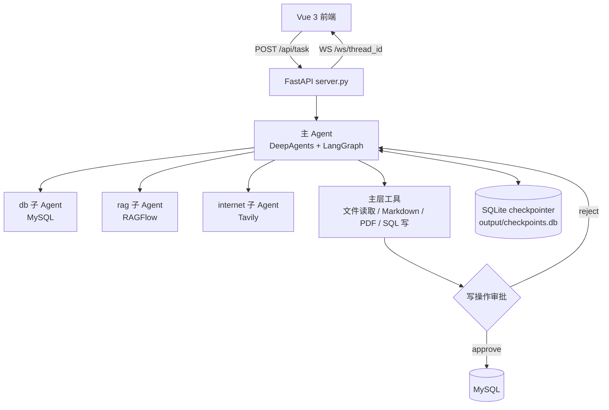

# DeepSearch · 药品信息多智能体助手

面向企业药品信息查询与运营辅助场景的多智能体 Agent。一个主 Agent 负责理解需求与调度，三个领域子 Agent 负责取数，既能直接回答，也能查业务库、查知识库、联网检索、生成文件，并在写数据库前停下来等人工审批。

## 功能概览

- **多智能体协作**：主 Agent 通过 `task` 工具调度 `database` / `rag` / `internet` 三个子 Agent，主层做结果去重、冲突消解与结构化汇总。
- **显式任务规划**：复杂任务（≥3 步）先调 `write_todos` 输出结构化计划，执行中维护 `in_progress` / `completed` 状态，前端实时展示进度。
- **双层上下文压缩**：超过约 4000 token 用模型把旧消息压成四段式结构化摘要（会话目标 / 关键结论 / 已产出文件 / 后续步骤），再涨到约 8000 token 时清掉最旧的工具返回结果，被压掉的原文卸载到 backend 可回溯。
- **人机审批（HITL）**：`execute_sql_write` 每次调用都会中断，等前端回传 `approve` / `reject`，超时按拒绝处理（安全默认）。
- **多轮会话记忆**：SQLite checkpointer 按 `thread_id` 持久化对话状态，同一会话可连续追问。
- **协程级会话隔离**：`ContextVar` 携带 `thread_id` 与 `session_dir`，并发会话的日志、文件输出、WebSocket 推送互不串流。
- **实时轨迹推送**：WebSocket 把会话创建、工具调用、子 Agent 调用、规划变更、审批请求、最终结果逐条推给前端。
- **文件产出**：主 Agent 可生成 Markdown 并转 PDF，产物落在 `output/session_xxx/`，通过 `/api/download` 取回。

## 系统架构



主 Agent 的中间件按顺序装配：上下文压缩 → 工具结果清理 → 任务规划 → 工具异常自省。

## 核心设计

1. **职责分层**：主 Agent 只做规划、调度与汇总，取数全部下沉到子 Agent，避免单一 Agent 工具过多导致选错工具。
2. **压缩不丢信息**：摘要固定四段结构，并明确要求记录「已产出文件」与「后续步骤」，防止长会话中文件路径、未完成事项被压没。
3. **写操作必须审批**：通过 `create_deep_agent` 的 `interrupt_on` 把 `execute_sql_write` 交给 `HumanInTheLoopMiddleware`，中断由 LangGraph 原生 `interrupt()` 完成，审批结果由 WebSocket 回传唤醒挂起任务。
4. **工具异常不崩溃**：`ToolErrorMiddleware` 把异常转成结构化提示交回模型，模型据此换工具、改参数或按降级链切换数据源（知识库 → MySQL → 联网搜索），并在都取不到时如实说未找到。
5. **会话隔离靠 ContextVar 而非全局变量**：协程级变量随请求上下文传递，WebSocket 推送与文件落盘都能定位到正确会话。

## 技术栈

| 层次 | 选型 |
| --- | --- |
| Agent 框架 | DeepAgents（`create_deep_agent`）、LangGraph、LangChain |
| 记忆 / 持久化 | `langgraph-checkpoint-sqlite`（AsyncSqliteSaver） |
| 后端 | FastAPI + Uvicorn、WebSocket |
| 业务数据库 | MySQL（`mysql-connector-python`）+ SQL 脚本 |
| 知识库 | RAGFlow SDK |
| 联网检索 | Tavily |
| 大模型 | DashScope（qwen-flash，OpenAI 兼容接口） |
| 文件处理 | python-docx、openpyxl、pypdf、Markdown |
| 前端 | Vue 3 + TypeScript + Vite |
| 工程 | uv、Python 3.12+ |

## 目录结构

```text
deep-search/
├── main.py                 # 入口：启动 FastAPI 服务（0.0.0.0:8000）
├── api/
│   ├── server.py           # 任务、上传、下载、WebSocket 路由
│   ├── approval.py         # 审批挂起/唤醒
│   ├── context.py          # ContextVar 会话上下文
│   └── monitor.py          # WebSocket 连接与推送管理
├── agent/
│   ├── main_agent.py       # 主 Agent：中间件装配、checkpointer、interrupt_on
│   ├── sub_agents/         # db / rag / internet 三个子 Agent
│   ├── llm.py              # 模型初始化
│   └── load_prompt.py      # Prompt 加载
├── tools/                  # MySQL、RAGFlow、Tavily、Markdown、PDF、文件读取工具
├── prompt/                 # 各 Agent 的 System Prompt
├── sql/db.sql              # 业务库建表与初始数据
├── ui/                     # Vue 3 + Vite 前端
├── utils/                  # 路径、日志、格式转换
├── output/                 # 会话产物与 checkpoints.db（已 gitignore）
└── upload/                 # 用户上传文件（已 gitignore）
```

## 快速开始

**1. 准备依赖服务**

- MySQL 8.x，并导入建表脚本：`mysql -u root -p < sql/db.sql`
- RAGFlow（rag 子 Agent 使用，按实际部署填写地址与 Key）
- 阿里云百炼 DashScope API Key
- Tavily API Key（联网检索）

**2. 安装依赖**

```bash
uv sync
```

**3. 配置环境变量**

```bash
cp .env.example .env
# 填写 DASHSCOPE_API_KEY、TAVILY_API_KEY、RAGFLOW_API_KEY 与 MySQL 连接信息
```

**4. 启动后端**

```bash
uv run python main.py     # http://127.0.0.1:8000
```

**5. 启动前端**

```bash
cd ui
npm install
npm run dev               # http://localhost:5173
```

前端默认连接 `ws://localhost:8000/ws/{thread_id}`，若后端地址变化需同步修改 `ui/src/App.vue` 中的 WebSocket 地址。

## 接口一览

| 方法 | 路径 | 说明 |
| --- | --- | --- |
| POST | `/api/task` | 提交自然语言任务，返回 `thread_id` |
| POST | `/api/upload` | 上传待分析文件（Excel / PDF / Word 等） |
| GET | `/api/files` | 列出当前会话产物 |
| GET | `/api/download` | 下载产物文件 |
| WS | `/ws/{thread_id}` | 双向通道：接收任务事件，回传审批决策 |

**WebSocket 事件类型**

| 事件 | 含义 |
| --- | --- |
| `session_created` | 会话创建，返回 session 目录 |
| `todo_update` | 任务计划新增或状态变更 |
| `agent_reasoning` | 主 Agent 推理摘要 |
| `tool_start` | 工具调用开始（含参数） |
| `assistant_call` | 子 Agent 调用与结果 |
| `approval_request` | 写操作审批请求，等待前端决策 |
| `task_result` | 最终答案与产物路径 |
| `error` | 异常信息 |

## 说明

- `.env`、`output/`、`upload/`、`ui/node_modules/` 已在 `.gitignore` 中排除，仓库内不含密钥、会话产物与依赖目录。
- 审批采用超时即拒绝的默认策略，避免无人值守时写操作被静默放行。
